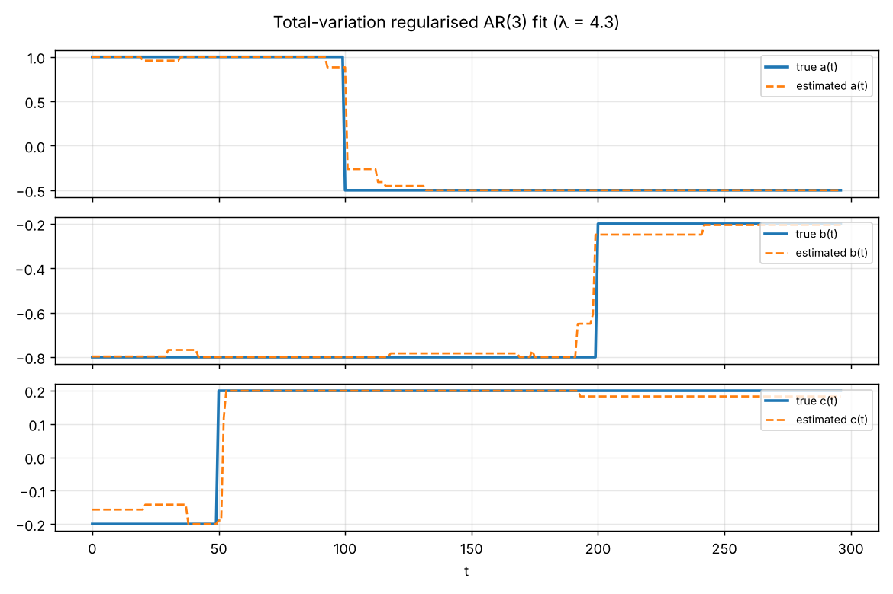

# Change Detection in a Time-Varying AR Model via Convex Optimisation

The signal follows a third-order autoregressive model whose coefficients jump at unknown times:

$$y(t+3) = a(t)\,y(t+2) + b(t)\,y(t+1) + c(t)\,y(t) + v(t)$$

Finding the change points means finding coefficient sequences with few changes. That is a cardinality
(ℓ₀) problem, which is non-convex, so it is relaxed to a **total-variation (ℓ₁ on first differences)**
penalty:

$$\min_{a,b,c}\ \sum_t \big(y(t+3) - a_t y(t+2) - b_t y(t+1) - c_t y(t)\big)^2
\;+\; \lambda \sum_{x\in\{a,b,c\}} \sum_t |x_{t+1}-x_t|$$

with box constraints a ∈ [−0.5, 1], b ∈ [−0.8, −0.2], c ∈ [−0.2, 0.2].



*CVXPY solution with λ = 4.3. All three change points (t = 50, 100, 200) are recovered.
Coefficient MSE: a 0.0094, b 0.0020, c 0.0015.*

## Files

| File | What it does |
| --- | --- |
| `CVX.m` | Solves the convex problem with CVX (MATLAB) |
| `CVX_grid.m` | Same, with a grid search over λ |
| `PGD.m` | Iterative solver: subgradient step on the TV term, then projection onto the box constraints |
| `PGD_grid.m` | Same, with a grid search over λ |
| `change_detection_cvx.py` | Python/CVXPY port of `CVX.m` that produces the figure above |
| `change_detection.mat` | Data: `y` (300 samples) and the true `a`, `b`, `c` |

## Running

MATLAB with [CVX](https://cvxr.com/cvx/) installed:

```matlab
CVX        % or CVX_grid, PGD, PGD_grid
```

Python:

```bash
pip install -r requirements.txt
python change_detection_cvx.py --lam 4.3 --save figures/cvx_estimate.png
```

Course assignment, convex optimisation, MSc Electrical Engineering, TU Delft.
